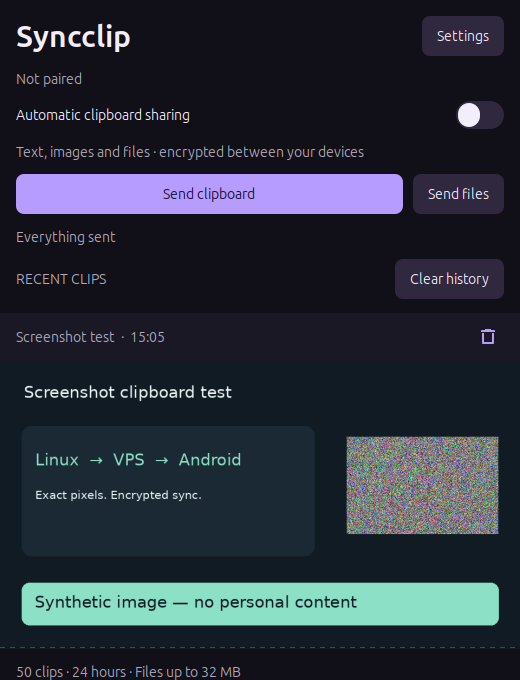

# Syncclip

Share **text, screenshots and files between Linux and Android** through a server you control. Native apps, fast background delivery, and encryption before anything leaves your device.

**Copy on Linux → pick it up on Android.** On Android, use **Share → Syncclip** or **Send clipboard** to send something back. Screenshots copied by another Linux app sync automatically.

## Install

### Android

[Download the APK](https://github.com/pandora-appbox/Syncclip/releases/download/v0.4.2/Syncclip-0.4.2.apk), open it, and allow installation when prompted. Requires Android 8 or newer. To update, install over the existing app.

### Linux

**Ubuntu 24.04 / Mint 22 (x86-64):** [download the Debian package](https://github.com/pandora-appbox/Syncclip/releases/download/v0.4.2/syncclip_0.4.2_amd64.deb), then run in your Downloads folder:

```sh
sudo apt install ./syncclip_0.4.2_amd64.deb
```

Open **Syncclip** from your app menu. It stays in the tray and starts at login.

**Other Linux desktops:** [download the installer archive](https://github.com/pandora-appbox/Syncclip/releases/download/v0.4.2/Syncclip-0.4.2-linux.tar.gz). See the expandable Linux instructions below for prerequisites and installation.

[All downloads](https://github.com/pandora-appbox/Syncclip/releases/tag/v0.4.2) · [Gitea mirror](https://gitea.pandoraappbox.com/hal/Syncclip/releases) — private for now; sign in to download.

## Connect your devices

1. **Start your server.** Follow the [Docker setup guide](docs/HOSTING.md). A home server or rented server works; both devices need to reach it over HTTPS.
2. **Pair Linux and Android.** Import the generated pairing link on both devices, or scan Linux's pairing QR code with Android.
3. **Copy and share.** Text and screenshots copied on Linux sync automatically. On Android, use **Share → Syncclip** or **Send clipboard**. Per-clip notifications can be turned off in Settings.

## What you get

- Text, PNG/JPEG/WebP screenshots and other files up to **32 MiB** each.
- Recent history, individual deletion and **clear history now** across paired devices.
- Settings at the top, pause controls, optional receipt alerts, and English/French/Spanish/Russian.
- Encrypted local history and offline retry when a device reconnects.
- A small Docker relay that stores encrypted data; no database is required.

**Keep in mind:** automatic Linux clipboard capture is verified on X11; Wayland support depends on your desktop. Android requires an explicit Share/Send action to read its clipboard. Battery restrictions can delay delivery while the phone sleeps. **Everything copied on Linux—including passwords—can sync while automatic sharing is on.** Pause it when needed. Your pairing link gives access to the whole device group: keep it private.

[Privacy policy](PRIVACY.md) · [Report a security issue](SECURITY.md)

## Screenshot



The preview uses synthetic test content; no pairing keys are included.

<details>
<summary><strong>Linux installation, updates & removal</strong></summary>

The Debian package targets Ubuntu 24.04 / Linux Mint 22 on x86-64 with Python 3.12. It adds an app-menu entry; the first launch creates a private Python environment in your home directory. It does not replace system Python. Updates keep pairing and history.

For the tar installer on Debian/Ubuntu-based desktops:

```sh
sudo apt install python3-gi gir1.2-gtk-3.0 python3-venv gir1.2-ayatanaappindicator3-0.1 qrencode
./scripts/install-linux.sh
syncclip
```

Python 3.12/x86-64 uses the included wheels offline; other supported Python versions/architectures download the exact pinned dependencies. Other distributions need equivalent GTK 3, PyGObject and venv packages. They have not been verified individually. qrencode is optional for showing a QR code; pairing by link works without it.

To remove the Debian package, run `sudo apt remove syncclip`. User data and the per-user launcher remain, so an apt removal does not erase your clips. To remove everything, disconnect in Settings, then remove `~/.local/share/syncclip`, `~/.local/bin/syncclip`, `~/.local/share/applications/dev.syncclip.Linux.desktop`, and `~/.config/autostart/syncclip.desktop`.

Android updates must use the same signing key. Install a newer signed APK over the existing app; do not uninstall it first.

</details>

<details>
<summary><strong>Run your own server: Docker, HTTPS, configuration & backups</strong></summary>

See [the server guide](docs/HOSTING.md) for a home-server walkthrough, existing-proxy configuration, commands, backup/restore and updates. The supplied release archive includes ready x86-64 container images. Its installer needs Docker Engine with Compose and Python 3; it generates the private pairing bundle locally and starts a non-root relay with bounded memory, a read-only root filesystem and persistent encrypted storage.

```sh
./scripts/setup-server.sh https://sync.example.com/syncclip --public
```

Use `--public` only if ports 80/443 are available for the included Caddy HTTPS proxy. On a server already running nginx/Caddy, omit it and configure the existing proxy. Never expose port 8787 directly to the internet.

</details>

<details>
<summary><strong>Privacy, retention & platform limits</strong></summary>

AES-256-GCM encrypts text, attachment bytes and filenames on the sending device. The relay receives ciphertext and separate authentication information. All paired devices share one trusted group; there are no individual accounts or per-device revocation. Rotate the group key and re-pair remaining devices if a device is lost. Encryption does not hide traffic sizes or timing, and any paired device can read the group's clips.

History keeps up to 50 clips for 24 hours. Text is limited to 64 KiB; supported images to 8 MiB / 24 megapixels; general files to 32 MiB. Up to 20 encrypted clips queue offline. Shared deletion removes retained data when devices reconnect; saved copies outside Syncclip stay intact. The system clipboard follows the operating system's lifetime, separately from history retention. Folders must be archived before sharing.

Android receives through a foreground service and does not use accessibility, root or a replacement keyboard. Open it once after reboot. Some paste destinations do not accept file/image URIs. Linux file copying uses a private temporary plaintext export removed on deletion/expiry; explicit saved copies remain. See [advanced behavior and security notes](docs/ADVANCED.md#privacy-and-recovery).

</details>

<details>
<summary><strong>Build, verification & licenses</strong></summary>

For F-Droid listing and reproducible APK builds, see [the preparation guide](docs/FDROID.md).

Syncclip's own code is **MIT licensed**. See [LICENSE](LICENSE) and [dependency licenses and original notices](THIRD_PARTY_NOTICES.md). Third-party licenses remain in force.

Android builds require JDK 17 and Android SDK 36; the wrapper pins Gradle 8.14.6. Build a signed release with `python3 scripts/build-release.py`. Keep `private/android-release.keystore` and its password backed up privately; never commit them. Debug CI artifacts are for development and are not the downloadable release APK.

The Docker build uses Go 1.27.3. See [verification evidence](VERIFICATION.md), [advanced build/test instructions](docs/ADVANCED.md#verification), and [Linux packaging](scripts/build-linux-release.py). Runtime dependencies are pinned. The optional manual workflow checks known advisories; GitHub Actions is disabled to avoid consuming build minutes. The Docker deployment has separate security verification recorded with the release.

</details>
